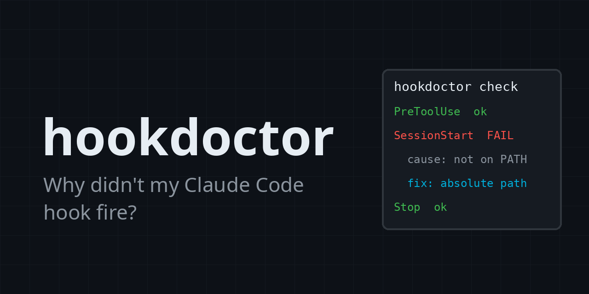

**Your Claude Code hook never fired, and nothing told you why. hookdoctor names the cause in one command.**

Hooks fail silently: a command that isn't on the app's PATH, a matcher regex that doesn't compile, a settings file with a JSON typo, a hook that exits 3 when the contract wants 0 or 2. Claude Code says nothing; your automation just doesn't happen.

hookdoctor loads every hook from your user, project and local settings and checks it statically: settings JSON, event names, matcher regexes, command resolution, executable bits. With the opt-in `-exec` flag it also dry-runs each hook with a synthetic payload and validates the output contract:

```text
$ hookdoctor check
[error] project/PreToolUse: matcher "[bad" is not a valid regex
  fix: fix the matcher; an uncompilable matcher never matches
[error] project/SessionStart: command "/opt/hooks/notify.sh" does not exist
  fix: point the hook at the real path; remember GUI apps do not see your terminal PATH
hookdoctor: 1 hooks healthy, 2 errors, 0 warnings
```

## What it checks

**Static (default, runs nothing)** - settings JSON parses, event names are real, matcher regexes compile, the command exists and is executable, hook type is supported.

**Dry run (opt-in, `-exec`)** - each hook gets a synthetic payload matching its event's documented schema, then hookdoctor validates the contract: exit code semantics (0 ok, 2 blocks with stderr to the agent, anything else is a crash), stdout JSON validity, and timeouts.

Every finding names a cause and the concrete next step. Diagnosis covers the failure modes above; a hook can still fail for reasons outside them (a runtime bug in the hook itself, conditions the synthetic payload does not trigger).

## Use it

```sh
go install github.com/ofershap/hookdoctor@v0.1.0
hookdoctor check
```

| Flag | Default | Meaning |
| --- | --- | --- |
| `-root` | `.` | Project root (project + local settings layers) |
| `-event` | all | Only check one event, e.g. `-event PreToolUse` |
| `-exec` | off | Dry-run hooks with synthetic payloads. Runs the hook commands, which are arbitrary code: enable only for repos you trust |
| `-settings` | - | Extra settings file to check (repeatable) |
| `-format` | `text` | `text` or `json` |
| `-max-timeout` | `30` | Per-hook dry-run cap in seconds |

Exit code is 1 when any error-level finding exists, so it gates CI over a dotfiles repo.

## What it doesn't do

- It never changes your settings or your hooks. Diagnosis only.
- Dry runs are OFF by default. Static mode never executes anything. `-exec` opts in and runs your hook commands - arbitrary code with real side effects, including any network or paid API calls they are written to make. It is not a sandbox; enable it only for repos you trust.
- It is not a hook framework or generator - it doesn't write hooks for you.

---

## Author

[](https://gitshow.dev/ofershap)

[](https://linkedin.com/in/ofershap)
[](https://github.com/ofershap)
[](https://ofershap.github.io/)

---

<sub>README built with [README Builder](https://ofershap.github.io/readme-builder/)</sub>

## License

[MIT](LICENSE) &copy; [Ofer Shapira](https://github.com/ofershap)
